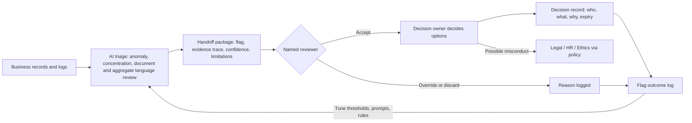

# Human in the loop: where AI isn't enough

**[Guardrails](../07-guardrails-and-ethics.md) say what AI may and may not do. This page says where decisions must sit with people** - who decides, on what evidence, and what gets recorded. The two are designed to be read together.

AI in this project produces **flags with evidence, confidence and limitations**. People produce **decisions with names, rationale and records**.

## Decision points

| Decision | What AI provides | Why AI isn't enough | Who decides (role) | Required evidence | What gets recorded |
|---|---|---|---|---|---|
| Final risk acceptance and risk appetite calls | Risk indicators, trends, concentration, comparable cases | Appetite is a value and business choice; accountability must be personal | Risk owner (1st line) within delegated authority; executive / risk committee above it | Risk analysis, options, cost of treatment, second-line view | Acceptance with signatory, authority level, rationale, expiry and review date |
| Whether and how to raise a concern involving a person | Process-level anomaly (e.g., overrides clustered under one approver role) | Fairness, context, proportionality, legal and employment implications | Second-line lead with Ethics / Legal / HR; Internal Audit if independent review needed | Corroborated process evidence; innocent explanations tested | Decision to raise or not, channel used, reasoning; restricted access |
| Interpreting ambiguous behavioral signals | Pattern, frequency, comparison to baseline | Context, culture, legitimate explanations (seasonality, known events, local practice) are often not in the data | Analyst, then risk owner | Signal + corroborating hard data + inquiry notes | Interpretation, explanations considered, conclusion |
| Materiality, finding severity, audit conclusions and opinions | Analytics results, exception counts, draft write-ups | Professional judgment and auditor responsibility (IIA Principle 4, Standards 14.3, 14.5 [S8]) | Engagement lead; Chief Audit Executive for opinions | Workpapers meeting 14.1/14.6 | Rating rationale, reviewer sign-off |
| Supplier termination, dual-sourcing, buffer stock | Concentration maps, performance trends, alternate-supplier data | Commercial, legal, contractual and relationship trade-offs | Category manager / procurement lead; executive for critical suppliers | Exit analysis, contract terms, cost, continuity plan | Decision, options rejected and why, owner, date |
| Escalation to Legal, HR or Ethics | Flag that a pattern may involve misconduct or legal exposure | Requires judgment on privilege, rights of individuals, regulatory duty | Second-line lead or Internal Audit, per escalation policy | Corroborated evidence package | Escalation record, recipient, date, follow-up |
| Overriding or accepting AI output | Flag, confidence, limitations, evidence trace | Only a person can weigh context the model lacks; risk of automation bias | Reviewer receiving the handoff | Flag package; own check of source records | Accept / override / discard, reason, reviewer name - feeds tuning |
| Accountability when AI output is wrong | Error detection metrics, flag outcome log | Someone must own correction and disclosure | Named AI tool owner (second line) | Error report, impact assessment | Error log entry, correction, who was informed, model/prompt change |

## The handoff flow

## What every handoff package contains

1. The flag in one sentence, at process level.
2. Evidence trace: the records behind it, with links or IDs.
3. **Confidence** (high / medium / low) and why.
4. **Limitations**: data gaps, period covered, what the AI cannot know.
5. Model/tool, version, prompt or rule set, run date.
6. Suggested questions for the reviewer - never a suggested conclusion about a person.

## Five handoff examples

> Illustrative. Each maps to a [scenario](../04-scenarios/).

### H1 - Single-source supplier with stale due diligence
*Scenario [S1](../04-scenarios/S1-the-supplier-we-always-use.md)*

| Part | Content |
|---|---|
| Flag package | "Critical part single-sourced from Alder Castings; DD financial review and certificate expired; 2 waivers with identical reason; scorecard Green while OTIF fell 9 points." Confidence: high (DD gaps), medium (trend, 4 quarters). Limitations: tier-2 data self-reported; no visibility of informal remediation. |
| Receiving role | Category Manager (risk owner); TPRM lead (second line) |
| Questions to answer | Is the OTIF drop explained? Is the waiver reason acceptable under policy? Is the dependency within appetite? |
| Decision options | Refresh DD now / qualify second source / build buffer stock / accept with expiry date |
| Documentation and sign-off | Risk register entry signed by Category Manager; TPRM lead countersigns any acceptance on a critical supplier |
| Feedback loop | Outcome logged against flag; if DD gaps were real, keep threshold; if trend was explained, add the known-event field to the model's inputs |

### H2 - Bank-detail change pushed through at quarter-end
*Scenario [S2](../04-scenarios/S2-quarter-end-expedite-rush.md)*

| Part | Content |
|---|---|
| Flag package | "Supplier bank details changed 3 days before quarter-end; no call-back recorded; request cites senior approval." Confidence: high (rule-based). Limitations: AI cannot tell whether a call happened off-system. |
| Receiving role | AP Manager (immediate); Controller; Internal Audit / Ethics if override is suspected |
| Questions to answer | Was the change verified with the supplier on the number on file? Should the payment be held? Does the pattern suggest control override? |
| Decision options | Hold payment and verify / release after verification / escalate as potential fraud |
| Documentation and sign-off | Verification record; Controller signs release or escalation; escalation via policy, not to the people involved |
| Feedback loop | Confirmed false positives (verified changes) tune the rule to read the call-back field; confirmed issues trigger control redesign |

### H3 - Forecast overrides and no recorded dissent
*Scenario [S3](../04-scenarios/S3-the-forecast-nobody-challenged.md)*

| Part | Content |
|---|---|
| Flag package | "Consensus forecast overridden upward by the same role in 9 of 9 cycles; minutes record no alternatives; plan bias positive throughout." Confidence: medium. Limitations: minutes may not capture discussion; aggregate language review only. |
| Receiving role | S&OP process owner; CFO for appetite on inventory and take-or-pay |
| Questions to answer | Did overrides have a documented basis? Is the inventory and take-or-pay exposure within appetite? |
| Decision options | Add challenge role and override threshold / accept current process with monitoring / reduce commitment |
| Documentation and sign-off | Process change approved by S&OP owner; appetite decision by CFO |
| Feedback loop | Track override accuracy; if overrides prove informed, lower flag weight for that signal |

### H4 - Repeated deviation acceptances near ship dates
*Scenario [S4](../04-scenarios/S4-friday-evening-risk-acceptance.md)*

| Part | Content |
|---|---|
| Flag package | "Same out-of-spec characteristic accepted 4 times this year; 3 of 4 within 24 hours of a ship date; Quality sign-off missing on 2." Confidence: high on facts; AI cannot judge technical acceptability. |
| Receiving role | Head of Quality (independent of plant line); Risk/Compliance for process gap |
| Questions to answer | Was each acceptance technically sound? Was approval within delegated authority? Is there a safety or customer-notification duty? |
| Decision options | Retroactive technical review / customer notification / supplier corrective action / tighten acceptance rule |
| Documentation and sign-off | Technical review signed by Quality; any customer notification approved by Legal |
| Feedback loop | Add "objection recorded elsewhere" check to document review; log outcome |

### H5 - Softened escalation language vs rising returns
*Scenario [S5](../04-scenarios/S5-returns-that-got-softer.md)*

| Part | Content |
|---|---|
| Flag package | "Across 24 reports, severity wording moved from 'failure' to 'monitoring' while RMAs rose; 'customer misuse' coding share rising vs. lab findings." Confidence: medium. Limitations: small lab sample; language analysis cannot know intent; authors anonymized. |
| Receiving role | Head of Quality; Product Safety / Legal if safety possible; supplier risk owner |
| Questions to answer | Is the risk understated? Is coding accurate? Does this trigger a safety review? |
| Decision options | Re-escalate / recode and re-analyze / supplier corrective action or exit analysis |
| Documentation and sign-off | Re-escalation memo signed by Head of Quality; decision on supplier by risk owner |
| Feedback loop | Reviewer marks which language changes mattered; prompt updated to quote metrics alongside wording |

## When the AI is wrong: accountability

| Element | Practice |
|---|---|
| Named owner | Every AI tool has a named owner role in the second line, listed in the AI inventory |
| Error log | Every false positive, false negative found later, and wrong extraction is logged with impact |
| Correction | Owner fixes data, prompt, rule or threshold; change is approved and versioned |
| Disclosure | Anyone who acted on a wrong flag is told; if it reached an audit finding or a decision record, that record is corrected and annotated |
| Review | Error rates reported to the risk committee periodically; tool paused if errors exceed agreed tolerance |

## Framework ties

- **NIST AI RMF:** GOVERN 2.1 (roles, responsibilities and lines of communication documented), GOVERN 3.2 (roles for human-AI configurations and oversight defined), MAP 3.5 (processes for human oversight defined and documented) [S1][S2]. MEASURE and MANAGE at function level for error tracking and response.
- **EU AI Act Article 14 (Human oversight)** applies to **high-risk** AI systems. It expects overseers to understand capabilities and limitations, stay aware of automation bias, correctly interpret output, and be able to disregard, override or reverse it [S11]. Process-level supply chain triage is not itself listed as high-risk, but Article 14 is a sound design reference. Note: AI used to monitor and evaluate the performance and behaviour of workers is listed as high-risk (Annex III, point 4(b)) [S12] - one more reason this project stays at process level.
- **IIA Standards:** Principle 4 (Exercise Due Professional Care) and Standard 4.3 (Professional Skepticism); Standards 14.3 and 14.5 for finding significance and conclusions; Standard 11.5 (Communicating the Acceptance of Risks) when management accepts a risk audit considers beyond appetite [S8].
- **COSO ICIF:** Principle 3 (structures, reporting lines, authorities) and Principle 5 (accountability) [S6].

---
[Back to README](../README.md)
