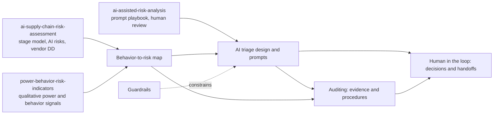

# Behavioral Supply Chain Risk: Human Factors, AI, and Audit

**A GRC portfolio project: how human behavior creates supply chain and third-party risk, how AI can surface the traces it leaves, how auditors turn those traces into evidence, and where people - not AI - must make the call.**

For hiring managers in GRC, third-party risk (TPRM), supply chain risk and internal audit.

## Summary

Supply chain risk programs measure suppliers; this project looks at the decisions around them. Biases, authority, long-time trust, groupthink, deadline pressure and incentives quietly bend decisions at every stage (plan, source, make, deliver, return), and each leaves a trace in ordinary records: override logs, due-diligence waivers, risk acceptances, contract changes, meeting minutes. The project maps those behaviors to observable signals, shows where AI can triage them alongside hard metrics (lead time, OTIF, concentration), how internal audit can test them, and which decisions must stay with a named person. It analyzes **processes and documents, never individuals' psychology**.

> Scenarios are fictional and labeled; the one real case (Kobe Steel, 2018) is cited from the company's own report. Ratings and numbers in scenarios are illustrative.

## Why it matters

Kobe Steel's 2018 investigation report traced years of falsified quality data partly to a culture that prioritized winning orders and meeting delivery deadlines over quality, an insular organization with little personnel rotation, and internal audits that were not extensive enough [S13]. None of that shows up on a supplier scorecard. All of it shows up in records - if someone knows what to look for.

## Five threads

| Thread | Where |
|---|---|
| Supply chain risk | Stage model reused from [ai-supply-chain-risk-assessment](https://github.com/Starboy1968/ai-supply-chain-risk-assessment) |
| Behavioral signals | [02-behavior-risk-map](02-behavior-risk-map/) |
| AI integration | [03-ai-integration](03-ai-integration/) |
| Auditing | [05-auditing](05-auditing/) |
| Human in the loop | [06-human-in-the-loop](06-human-in-the-loop/) |

## The map at a glance

| Behavior | Where in the supply chain | Observable signal | Data source | How AI helps | What a human must judge |
|---|---|---|---|---|---|
| Trust / lock-in | SOURCE | DD waived "because we know them"; one buyer owns supplier for years | DD tracker, assignment history | Finds waivers, expired items, long single-owner tenures | Is the waiver acceptable? Is rotation needed? |
| Confirmation bias | SOURCE | Scorecard Green for years while OTIF falls | Scorecards, OTIF | Flags scorecard vs. metric divergence | Are criteria and scorer independence sound? |
| Deadline / incentive pressure | DELIVER, ENABLE | Expedites and after-the-fact POs spike before quarter-end | Freight, P2P logs | Seasonality-adjusted anomaly detection | Legitimate demand or skipped controls? |
| Authority | MAKE, ENABLE | Quality holds released over objection; bank change "approved by VP" | Hold/release log, supplier master log | Flags overrides by role and timing | Legitimate intervention or override? |
| Groupthink / anchoring | PLAN | No alternatives or dissent in S&OP minutes; forecast never moves | Minutes, override log | Aggregate document review; override analytics | Is challenge happening? (never a judgment on attendees) |
| Sunk cost / softened escalation | RETURN | "Failure" becomes "observation" while returns rise | Escalation reports, RMA data | Aggregate wording trend vs. counts | Was the risk understated? Re-escalate? |

Full map by stage: [02-behavior-risk-map](02-behavior-risk-map/README.md) | Watch list: [12 qualitative indicators](02-behavior-risk-map/indicators.md)

## Scenario teaser

> *Fictional.* A plant director signs a deviation acceptance late on a Friday so a shipment can leave Monday. Quality objected by email, but the objection is not in the record. It is the fourth acceptance of the same deviation this year. AI flags the repeat and the timing; it cannot judge whether the metal is safe. The handoff goes to the Head of Quality, independent of the plant line, and audit tests every deviation acceptance against delegated authority. [Read S4](04-scenarios/S4-friday-evening-risk-acceptance.md) | [All five scenarios](04-scenarios/)

## How earlier projects feed in

## Skills demonstrated

- Supply chain and third-party risk analysis by stage (plan, source, make, deliver, return)
- Behavioral and risk-culture analysis turned into observable, process-level indicators
- AI governance: designing AI as triage, with prompts, guardrails, confidence and limitations
- Internal audit: evidence quality, management-override testing analogs, full-population analytics, auditing the AI
- Human-in-the-loop design: decision rights, handoff packages, accountability for AI errors
- Privacy and ethics: EU AI Act Art. 5(1)(f) emotion-recognition prohibition, proportionality, no employee surveillance
- Framework mapping: COSO ICIF 2013, COSO ERM 2017, NIST CSF 2.0 (GV.SC, GV.RR), NIST SP 800-161r1, NIST AI RMF, IIA Global Internal Audit Standards and Three Lines Model

## Repo map

| Path | What's inside |
|---|---|
| [01-project-brief.md](01-project-brief.md) | Objective, scope, questions, method |
| [02-behavior-risk-map/](02-behavior-risk-map/) | Full map by stage; [qualitative indicators](02-behavior-risk-map/indicators.md) |
| [03-ai-integration/](03-ai-integration/) | Five AI uses, flag-vs-decide table, [sample prompts](03-ai-integration/prompts.md) |
| [04-scenarios/](04-scenarios/) | Five fictional scenarios, each with AI, human handoff and audit angle |
| [05-auditing/](05-auditing/) | Audit trails, [evidence and procedures](05-auditing/evidence-and-procedures.md), [AI in audit and auditing the AI](05-auditing/ai-in-audit.md) |
| [06-human-in-the-loop/](06-human-in-the-loop/) | Decision-point table, handoff flow, five handoff examples, accountability when AI is wrong |
| [07-guardrails-and-ethics.md](07-guardrails-and-ethics.md) | What AI may not do; privacy, proportionality, audit-evidence guardrails |
| [08-framework-mapping.md](08-framework-mapping.md) | COSO, NIST, IIA, EU AI Act mapping (IDs verified) |
| [sources.md](sources.md) | Every source cited |

## Related projects

- [ai-supply-chain-risk-assessment](https://github.com/Starboy1968/ai-supply-chain-risk-assessment) - AI risks across the supply chain; stage model reused here
- [ai-assisted-risk-analysis](https://github.com/Starboy1968/ai-assisted-risk-analysis) - reusable risk-analysis prompt and worked example; prompt structure reused here
- [power-behavior-risk-indicators](https://github.com/Starboy1968/power-behavior-risk-indicators) - 22 qualitative power and behavior indicators; evidence ladder reused here
- [two-suppliers-one-factory](https://github.com/Starboy1968/two-suppliers-one-factory) - hidden tier-2 single points of failure
- [supply-web-audit](https://github.com/Starboy1968/supply-web-audit) - plain-English supply risk audit for small and mid-size businesses

## Author

Rashon Alsberry, supply chain and third-party risk analyst - [starboy1968.github.io](https://starboy1968.github.io)
